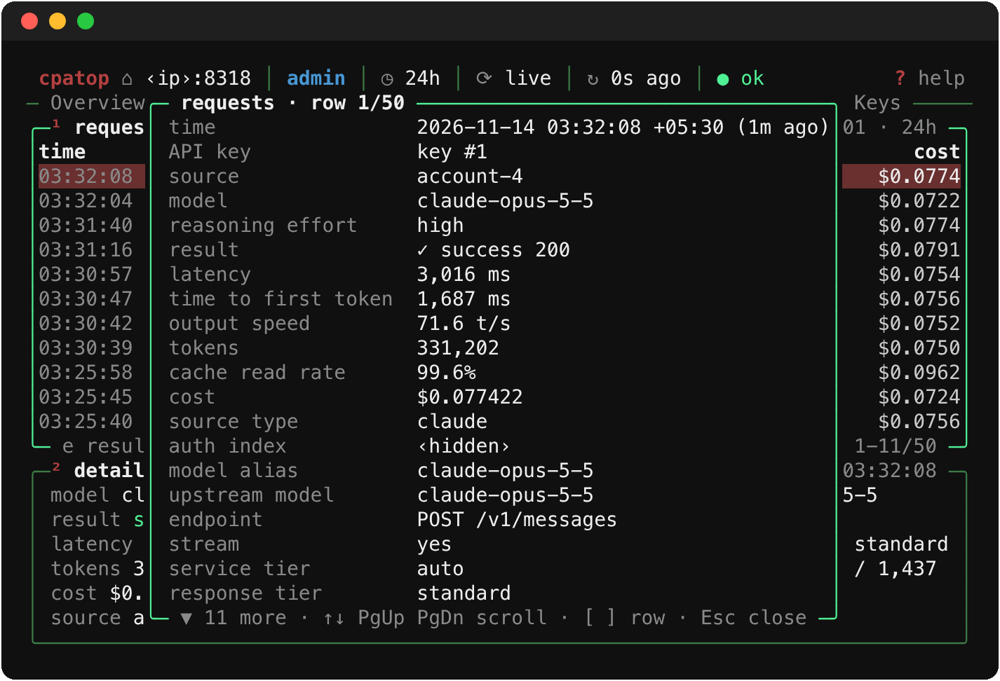

# cpatop


<sub>Admin overview, captured from a live Keeper at 160×48 with `--privacy`. More in [Screenshots](#screenshots).</sub>

A btop-style terminal dashboard for [CPA Usage Keeper](https://github.com/Willxup/cpa-usage-keeper)
(the usage/cost tracker for CLIProxyAPI), written in Rust with [ratatui](https://ratatui.rs).

It mirrors the Keeper web dashboard in your terminal: totals and trends, realtime
throughput, per-model / per-key / per-credential analysis, a live request log,
credential health, quota windows, pricing and sessions — with braille graphs,
gradient meters and sparklines.

## Features

- **Both Keeper roles.** An *admin* session gets every tab (Overview, Realtime,
  Analysis, Requests, Credentials, Quota, Models, Keys); a *CPA API key* session
  gets the per-key dashboard (Overview, Realtime, Analysis). The UI adapts to
  the role the server reports.
- **Live request log** over Server-Sent Events, with reconnect/backoff,
  `Retry-After` handling, `reset` frames and an idle watchdog; result, model
  and source filters run on the server, and scrolling to the bottom pages in
  older matching requests.
- **Time ranges** from presets or custom day/hour ranges, and an API-key
  filter, both through searchable pickers.
- **btop look:** rounded panes with `─¹ name ─` titles, braille/block/ascii
  graphs with axes, time ticks and a cursor, `■` meters, per-row sparklines,
  right-aligned numbers, labelled heatmaps.
- **Responsive:** panes and columns size to their content from 220×60 down
  to 80×24; when rows run out, low-priority panes collapse to one-line
  summaries instead of being squeezed.
- **Never blocks on the network:** each data group is polled by its own task on
  its own cadence; when a poll fails the last good data stays on screen and
  the header shows a stale marker.
- **Themes:** `default` (btop-like), `light`, `gruvbox`, `nord`, `tokyo-night`,
  `dracula`, `monochrome`, plus your own TOML themes.
- Persists theme, range, layouts, hidden panes, sorting and the last tab.

## Screenshots

All captured from a live Keeper with `--privacy`, reached at
`http://127.0.0.1:8318` to show that even the server address is masked:
e-mail addresses become `account-N`, API keys are shown only as `key #id`,
IP addresses become `‹ip›`.

| | |
|---|---|
|  |  |
| **Realtime** — throughput, outcomes, latency scatter, cache hit rate over the last 15 minutes | **Analysis** — token trend, composition, latency, speed, efficiency and key × model heatmap |
|  |  |
| **Requests** — live request log over SSE with a detail pane | **Server-side filters** — `e` shows failures only; `m`/`o` pick a model or source |
|  |  |
| **Credentials** — per-credential health, success rate and recent errors | **Quota** — every quota window per credential, with history |
|  |  |
| **Keys** — API keys with usage for the selected range, sessions | **Graph cursor** — `f` focuses a graph, `←`/`→` read exact bucket values |
|  |  |
| **Range picker** (`r`) — presets plus custom day/hour ranges | **API-key picker** (`a`) — searchable, keys named by id |
|  |  |
| **API-key mode** — the per-key dashboard | **Help** — `?` lists every key |
|  |  |
| **`light` theme** (Analysis) | **`tokyo-night` theme** (Realtime) |
|  |  |
| **220×60** — panes size to their content | **80×24** — low-priority panes collapse to one-line summaries |
|  | |
| **Row details** (`Enter`) — every field of the selected row, untruncated | |

## Install

```sh
curl -fsSL https://raw.githubusercontent.com/alimohammed1624/cpatop/main/install.sh | sh
```

The script picks the prebuilt binary for your machine — Linux x86_64 or
aarch64 (static musl), macOS Intel or Apple silicon — from the latest
[GitHub release](https://github.com/alimohammed1624/cpatop/releases),
checks it against the release's `SHA256SUMS` and installs it to
`~/.local/bin` without sudo (it tells you the line to add if that is not on
your `PATH`). Options:

- `CPATOP_INSTALL_DIR=/some/dir` — install somewhere else.
- `CPATOP_VERSION=v0.2.0` — install a specific release instead of the latest.

```sh
curl -fsSL https://raw.githubusercontent.com/alimohammed1624/cpatop/main/install.sh | CPATOP_INSTALL_DIR=~/bin sh
```

To read the script before running it:

```sh
curl -fsSL https://raw.githubusercontent.com/alimohammed1624/cpatop/main/install.sh -o install.sh
less install.sh
sh install.sh
```

**Uninstall:** run `cpatop logout` to end your server sessions, then delete
the binary (`rm ~/.local/bin/cpatop`). `cpatop paths` lists the config and
state directories, which you can delete too.

**Release archives by hand.** Each release has these archives plus
`SHA256SUMS`; each `cpatop-<target>.tar.gz` contains a `cpatop-<target>/`
directory with the binary:

| Archive | Platform |
| --- | --- |
| `cpatop-x86_64-unknown-linux-musl.tar.gz` | Linux x86_64 (static) |
| `cpatop-aarch64-unknown-linux-musl.tar.gz` | Linux aarch64 (static) |
| `cpatop-x86_64-apple-darwin.tar.gz` | macOS Intel |
| `cpatop-aarch64-apple-darwin.tar.gz` | macOS Apple silicon |
| `cpatop-universal-apple-darwin.tar.gz` | macOS, one binary for both (larger) |

The install script always picks the architecture-specific archive; download
the universal one by hand when you want a single binary that runs on both
Intel and Apple silicon Macs (e.g. to copy between machines).

```sh
base=https://github.com/alimohammed1624/cpatop/releases/latest/download
curl -fsSLO "$base/cpatop-universal-apple-darwin.tar.gz" -O "$base/SHA256SUMS"
grep ' cpatop-universal-apple-darwin.tar.gz$' SHA256SUMS | shasum -a 256 -c
tar xzf cpatop-universal-apple-darwin.tar.gz
install -m 755 cpatop-universal-apple-darwin/cpatop ~/.local/bin/
```

On Linux, use `sha256sum -c` and the `-unknown-linux-musl` archive name.

**With cargo** (Rust 1.88+):

```sh
cargo install --git https://github.com/alimohammed1624/cpatop --locked
```

**From source:**

```sh
git clone https://github.com/alimohammed1624/cpatop && cd cpatop
cargo build --release            # target/release/cpatop
# static Linux build:
rustup target add x86_64-unknown-linux-musl
cargo build --release --target x86_64-unknown-linux-musl
```

TLS uses rustls, so no OpenSSL is needed. OS-keyring support (macOS
Keychain, freedesktop Secret Service) is on by default; build with
`--no-default-features` to leave it out.

## Usage

```sh
# Admin dashboard, password read from a file
cpatop --password-file ~/.config/cpatop/admin.pw

# Per-key dashboard
cpatop --api-key-file ~/.config/cpatop/cpa.key

# Different server, including a sub-path deployment
cpatop --base-url https://host.example/keeper
CPATOP_BASE_URL=https://host.example/keeper cpatop

# No credential configured: an in-app login screen (Admin / API key) appears
cpatop
```

Other commands:

| Command | Purpose |
|---|---|
| `cpatop keyring set admin` / `api-key` | Store a secret in the OS keyring (hidden prompt) |
| `cpatop keyring delete admin` / `api-key` | Remove it |
| `cpatop logout` | Log out on the server and forget the stored session |
| `cpatop themes [--dump NAME]` | List themes / print one as a TOML starting point |
| `cpatop paths` | Show the config, theme and state paths in use |
| `cpatop check-update` | Check for a newer cpatop release now |

Useful flags: `--range 7d` (or `--range custom:2026-11-01..2026-11-07`),
`--refresh 5`, `--theme nord`, `--symbols block`, `--auth api-key` (prefer the
key when both credentials exist), `--privacy` (hide e-mails, keys and IPs),
`--no-mouse`, `--no-keyring`, `--fresh-session`, `--logout-on-exit`,
`--no-update-check`. Connection, credential and display flags may also follow a
subcommand (`cpatop logout --base-url http://host:8318`). `--theme`, `--range`,
`--refresh`, `--symbols` and `--privacy` apply to that run only; changes made in
the app (`t`, `r`, `+`/`-`, `b`, `x`) are remembered, also when they end on the
command-line value (`--privacy`, then `x` twice, keeps privacy on).

Sessions are remembered per server and role, and a stored session is checked
with the server (`GET /auth/session`) and reused on the next start — cpatop
only logs in again when it is no longer valid. **`q` keeps the server session**
for next time; `cpatop logout` (or `X X` in the app) ends it, and
`--logout-on-exit` (config `logout_on_exit = true`) ends it whenever you quit —
also when cpatop is stopped by `SIGTERM`, `SIGHUP` (terminal closed) or
`SIGINT`, which restore the terminal like `q`. A credential given explicitly
for this run (`--password-file`, `--api-key-file`, `CPATOP_PASSWORD`,
`CPATOP_API_KEY`) decides the role, so `--api-key-file` always opens the
per-key dashboard even when an admin session is stored.
Run `cpatop --help` for the full list.

## Keys

The focused pane lists its own keys in its bottom border; `?` shows them all.

| Key | Action |
|---|---|
| `Tab` / `Shift-Tab`, `←` `→` | Next / previous tab (or click a tab); `F2`…`F9` jump to a tab |
| `f` / `F` | Focus the next / previous table or graph (or click a pane) |
| `1`–`9` | Hide / show the pane with that number (panes are numbered left to right, top to bottom) |
| `0` | Show every pane hidden with `1`–`9` (hidden panes are listed next to the layout name) |
| `p` / `l`, `P` | Next / previous layout preset |
| `↑↓` `j`/`k`, `PgUp`/`PgDn`, `g`/`G` | Move the selection (mouse wheel scrolls) |
| `Enter` | Every field of the selected row's record, untruncated: `↑↓` `PgUp`/`PgDn` `Home`/`End` (or the wheel) scroll it, `[` `]` (or `Shift-↑↓`) step to the previous / next row, `Esc` closes |
| `/` | Find in the focused table (`Enter` keeps, `Esc` clears) |
| `s` / `S` | Sort by the next column / reverse |
| `d` | Switch dimension: models, API keys, credentials, AI providers (API-key providers) |
| `←` `→`, `g` `G` (graph focused) | Move the graph cursor and read exact bucket values; `Esc` removes it |
| `r` | Range picker: presets, custom days (YYYY-MM-DD), custom hours |
| `[` `]` | Previous / next preset range |
| `a` | API-key filter picker (admin) — type to search, `Enter` picks |
| `w` | Realtime window 15m / 30m / 60m |
| `e` | Requests: result filter all / success / failed (server-side) |
| `m` / `o` | Requests: model / source picker (server-side) |
| `c` | Requests: clear the filters |
| `+` / `-` | Slower / faster refresh |
| `R` | Refresh now |
| `t` / `T` | Next / previous theme |
| `b` | Graph symbols: braille / block / ascii |
| `b` (offline screen), `Ctrl-S` (login screen) | Change the server URL |
| `x` | Privacy mode: hide e-mails, API keys and IP addresses, and what you type into `/` and picker searches (remembered; the header shows `◐ private` while it is on) |
| `X` `X` | Log out on the server (press twice within 3 s) |
| `Esc` | Close the overlay / clear the filter or cursor — never quits |
| `?` | Help (scrolls with `↑↓` `j`/`k` `PgUp`/`PgDn` `g`/`G` or the wheel; `Esc`, `?` or `q` close it) |
| `q`, `Ctrl-C` | Quit — the server session is kept for the next start |

## Configuration

`$XDG_CONFIG_HOME/cpatop/config.toml` (see [`config.example.toml`](config.example.toml)).
Precedence: command line and environment → saved UI state → config file → defaults.

| File | Location |
|---|---|
| Config | `$XDG_CONFIG_HOME/cpatop/config.toml` |
| UI state (written automatically) | `$XDG_CONFIG_HOME/cpatop/ui-state.toml` |
| User themes | `$XDG_CONFIG_HOME/cpatop/themes/*.toml` |
| Session cookie (mode 0600) | `$XDG_STATE_HOME/cpatop/session.json` |
| Last update check (mode 0600) | `$XDG_STATE_HOME/cpatop/update-check.json` |

On macOS without `XDG_*` variables the platform directories are used
(`cpatop paths` prints them).

**Wrong or unreachable server.** When the base URL cannot be reached (refused,
DNS, timeout, TLS) or does not answer like a Keeper API, the offline screen
keeps retrying and offers `b` to change the server URL (`Ctrl-S` on the login
screen). The field starts with the current URL; `http://` is added when no
scheme is typed, a trailing `/` is dropped and a sub-path is kept. cpatop then
checks the server (`/api/v1/startup/status` and `/auth/session`, 5 s) and shows
what is wrong (invalid URL, unreachable, not a Keeper) so you can edit again.
A working URL is used right away — a stored session for that server is
reused, a configured credential logs in, otherwise the login screen appears —
and saved as `base_url` in the config file (`--config` if given; created with
mode 0600 if missing; other keys and comments are kept). A `--base-url` flag
or `CPATOP_BASE_URL` still wins on the next start, which the message points
out. In privacy mode the field shows the scheme, host name and port as in the
header (`http://localhost:8318`) and hides IP addresses, user info and the path
(`http://•••••••••:8318/••••••`).
With `--logout-on-exit`, a session held on the old server is logged out when you
switch (kept stored if that server cannot be reached); otherwise it stays stored.

Polling defaults: overview/realtime every 10 s (`+`/`-`, `--refresh`),
analysis, credentials, quota and keys every 60 s (`slow_refresh_secs`),
models on entry, range change or `R`; the request log is a live stream. The
header shows the cadence of the tab on screen (`⟳ 10s`, `⟳ 1m`, `⟳ live`,
`⟳ manual (R)`) and turns the age amber when refreshes were missed; panes whose
data is that old show `◌ stale`.

## Themes

A theme is a flat TOML file; every key is optional and falls back to the
`default` theme. Colours are `#rrggbb`, `#rgb`, an ANSI name (`red`,
`darkgray`, …) or `default` for the terminal's colour.

```toml
# ~/.config/cpatop/themes/mine.toml  →  selectable as "mine"
name = "mine"
main_bg = "default"
main_fg = "#cccccc"
title = "#eeeeee"
hi_fg = "#b54040"         # pane numbers, highlights
border = "#3d7b46"
border_focus = "#50f095"
selected_bg = "#6a2f2f"
selected_fg = "#eeeeee"
inactive_fg = "#8a8a8a"
graph_text = "#8a8a8a"
meter_bg = "#303030"      # empty meter cells
gradient_low = "#50f095"  # graph/meter gradient, bottom → top
gradient_mid = "#f2e266"
gradient_high = "#fa1e1e"
ok = "#50f095"
warn = "#f2e266"
err = "#fa4040"
accent = "#4897d4"
```

`cpatop themes --dump nord > ~/.config/cpatop/themes/my-nord.toml` gives you a
complete starting point. A user theme with a built-in name replaces it.

## Security

- **No secrets on the command line.** Credentials come from
  `--password-file`/`--api-key-file` (or the same keys in the config file),
  `CPATOP_PASSWORD`/`CPATOP_API_KEY`, the OS keyring, or the login screen —
  in that order. cpatop warns when a secret file is readable by others.
- **Only the session cookie is persisted**, never the password or API key, in a
  0600 file in the state directory. It is reused until the server answers 401;
  then cpatop logs in again if a credential source is available, otherwise it
  shows the login screen. A secret typed into the login screen is kept in
  memory only.
- Secrets are never logged or rendered (the login field shows bullets).
  API keys returned by the server are shown the way the web dashboard
  shows them — the server's own masked form, short prefix and six-character
  suffix (`abc…x1y2z3`); the raw-key endpoint `/usage/api-keys/settings` is
  never called.
- cpatop only issues GET requests, plus `POST /auth/login`,
  `/auth/api-key-login` and `/auth/logout`. It never changes Keeper settings
  or data, never triggers quota refreshes and never calls Keeper's
  GitHub-backed update check (`/update/check`).
- **Update check (cpatop's own).** At most once a day, in the background
  after the dashboard is up, cpatop asks GitHub for its own latest release:
  `GET https://github.com/alimohammed1624/cpatop/releases/latest` (the tag
  is read from the redirect, which is not followed), falling back to
  `https://api.github.com/repos/alimohammed1624/cpatop/releases/latest`.
  The request carries only a `cpatop/<version>` User-Agent — no Keeper
  URL, credentials or other identifiers. The answer is cached in
  `update-check.json` in the state directory; a newer stable release shows
  `↑ vX.Y.Z` in the header and the upgrade command in `?` help. Failures are
  silent and never delay startup (3 s timeout). Turn it off with
  `--no-update-check`, `update_check = false` in the config file or
  `CPATOP_NO_UPDATE_CHECK=1`; it is also skipped when `CI` is set.
  `cpatop check-update` checks on demand (ignoring the cache and the
  opt-outs) and prints one line; `cpatop --version` never goes online.
- Keeper buckets hourly series on UTC hours. In a zone with a half-hour
  offset (+05:30) buckets start at :30 local time; charts draw each bucket
  over its real time span (the first `today` bucket covers only 00:00–00:30,
  the one in progress ends at now, and so does the solid axis), and axis
  ticks sit on whole local hours. cpatop shows the server's numbers as they
  are, so in such a zone `today` differs between tabs: Overview counts from
  00:00, Analysis from the first UTC hour (its title reads `server buckets
  from 00:30`), and Overview's daily buckets run 00:30 → 00:30 (`days from
  00:30`). The activity grid's Σ covers the last N×24 hours (`rolling
  7×24h`), not calendar days. `?` help has these under "reading the
  numbers".
- Credentials that share a name carry their provider (`account-1 · claude`);
  where space is short the provider is abbreviated so the name stays whole:
  `cl` claude, `cx` codex, `ag` antigravity, `gm` gemini, `gc` gemini-cli,
  `vx` vertex, `as` aistudio, `oa` openai, `oc` openai-compatibility, `qw`
  qwen, `if` iflow, `km` kimi, `xa` xai (also listed in `?` help).
- `--privacy` (or `x`) hides every e-mail address, every part of an API
  key and every IP address, in tables, details, pickers, error text and the
  login and offline screens — handy for screenshots and screen sharing.
  While it is on the header shows `◐ private` (just `◐` when the terminal
  is narrow).
  Accounts are shown as `account-N` (N is the server's credential id, so
  labels are the same in every run), keys as `key #id` (aliases hidden),
  IPs as `‹ip›`; the server is shown as scheme, host and port only (an IP
  host becomes `‹ip›`, the path is dropped). User agents keep only their
  product tokens, endpoints lose their query string (`/v1/messages?…`) and
  unknown endpoints read `‹hidden›`. Free text masks the whole run around
  any `@`, URL query strings and fragments, and every token of 20+
  `[A-Za-z0-9_.+/=-]` characters unless it is a model name the server
  reported, a timestamp, an API route or a host name. As a last line of
  defence every rendered frame is scanned the same way and overwritten in
  place. E-mail addresses with quoted local parts (`"a \"b\" c"@x.org`) are
  masked from the start of their field. Text you type into `/` filters and
  picker searches is shown as bullets and a count (`••••• 5`) from the first
  character; filtering uses the real text. Everything cpatop prints outside
  the UI — errors, hints, warnings, reports, panics, argument errors — is
  scrubbed the same way; file paths in messages read `‹path›` (credential
  files `--password-file`), and `cpatop paths` keeps the useful part
  (`~/.config/cpatop/config.toml`), whenever privacy is on (`--privacy` for
  one run, `x` in the app, or `privacy = true` in the config).

## Development

CI and releases run on GitHub Actions (`.github/workflows/`):

- **CI** (`ci.yml`) runs on every push to `main`, every pull request and by
  hand: `cargo fmt --check`, `cargo clippy --all-targets -- -D warnings`
  and `cargo test` on Linux, clippy and tests on macOS, a static
  `x86_64-unknown-linux-musl` release build, shellcheck and actionlint. A
  new push to a pull request cancels its older runs.
- **Releases** (`release.yml`): bump `version` in `Cargo.toml`, add a
  `## [X.Y.Z]` CHANGELOG section (it becomes the release text), merge to
  `main`, then push a matching tag:

  ```sh
  git tag -a v0.3.0 -m "cpatop v0.3.0" && git push origin v0.3.0
  ```

  The workflow checks that the tag equals `v` + the `Cargo.toml` version and
  is on `main`, runs fmt, clippy and the tests, builds the Linux musl
  (`x86_64`, `aarch64`) and macOS (`x86_64`, `aarch64`, `universal`)
  archives, installs each platform's archive with `install.sh` on a matching
  runner, and publishes them with `SHA256SUMS`. A tag with a `-suffix`
  (`v0.3.0-rc.1`) makes a pre-release. Running it by hand from the Actions
  tab is a dry run: everything except publishing, with the archives kept as
  the `dist` artifact.

### Optional local tooling

Nothing below is required; it is a local pre-flight and a fallback for when
GitHub Actions is unavailable.

```sh
scripts/ci.sh              # fmt, clippy -D warnings, tests, musl build, lints
scripts/setup-hooks.sh     # opt in to the git hooks below, check tools
```

- `scripts/ci.sh` runs the CI checks on the committed `HEAD` (`--sha REV`
  for another commit). `--quick` runs only fmt, clippy and tests; `--mac`
  also runs them (plus an `aarch64-apple-darwin` build) on a Mac over ssh,
  reported as skipped if the Mac is offline. The log and result go to
  `.git/cpatop-ci/<sha>.log` and `.status`.
- Git hooks, off until you run `scripts/setup-hooks.sh` (it sets
  `core.hooksPath=.githooks`; `git config --unset core.hooksPath` turns them
  off again):
  - `post-commit` runs `scripts/ci.sh --mac` in the background for every
    commit on `main` and shows a desktop notification when it is done
    (`notify-send` or D-Bus; if neither works, or on failure, the next hook
    prints the result). `CPATOP_SKIP_CI=1` skips it; `CPATOP_CI_ARGS`
    overrides the flags.
  - `pre-push` refuses to push `main` if its local CI failed. If CI is
    missing or still running, `CPATOP_PREPUSH=wait` (default) waits for it
    or runs it, `warn` pushes anyway, `block` refuses. `git push
    --no-verify` bypasses it.
- `scripts/release.sh vX.Y.Z` is the fallback release path: from a clean,
  pushed `main` that has passed local CI, it builds both Linux musl archives
  here and the macOS ones on a Mac, writes `dist/` with the same assets and
  `SHA256SUMS` as the workflow, then tags, pushes the tag and runs
  `gh release create`. `--dry-run` stops after `dist/`. The pushed tag also
  starts the release workflow, which leaves the existing release alone.

The local tools need Rust, `flock`, `ssh`, and for the full run and releases
`cargo-zigbuild` with zig (`uv tool install cargo-zigbuild`) and the
`x86_64-unknown-linux-musl` / `aarch64-unknown-linux-musl` targets;
shellcheck, actionlint, `notify-send` and `gh` are optional (`gh` publishes
releases). The Mac is the ssh host `CPATOP_MAC_HOST` (default `mba`); it
needs non-interactive ssh (`BatchMode`), Xcode command-line tools and Rust
(`scripts/setup-hooks.sh --mac` installs rustup for the user). It gets the
exact commit via `git archive` over ssh and builds in `~/.cache/cpatop-ci/`.

Tests parse every recorded API response in `tests/fixtures/` (scrubbed real
Keeper v2.1.0 responses), snapshot the main screens with ratatui's
`TestBackend` at 80×24, 160×48 and 220×60 for both roles (`tests/snapshots/`,
via [insta](https://insta.rs)), check that privacy mode leaves no identifier
on any screen, drive the key bindings (`tests/keys.rs`) and run the client,
pollers, live stream and session handling against a mock Keeper
(`tests/http.rs`, via wiremock).

Release history: [CHANGELOG.md](CHANGELOG.md).

`scripts/screenshots.sh` regenerates the PNGs in `docs/screenshots/` from a
running Keeper (needs tmux, aha, chromium, ImageMagick and the "MesloLGS Nerd
Font Mono" font). It always runs cpatop with `--privacy` and throwaway config
and state directories, and logs its sessions out when done:

```sh
CPATOP_BASE_URL=http://localhost:8318 \
CPATOP_SHOT_PASSWORD_FILE=path/to/admin.pw \
CPATOP_SHOT_API_KEY_FILE=path/to/cpa.key \
  scripts/screenshots.sh            # SHOT_ONLY="admin-overview" for one scene
```

## License

MIT — see [LICENSE](LICENSE).
