# cpatop

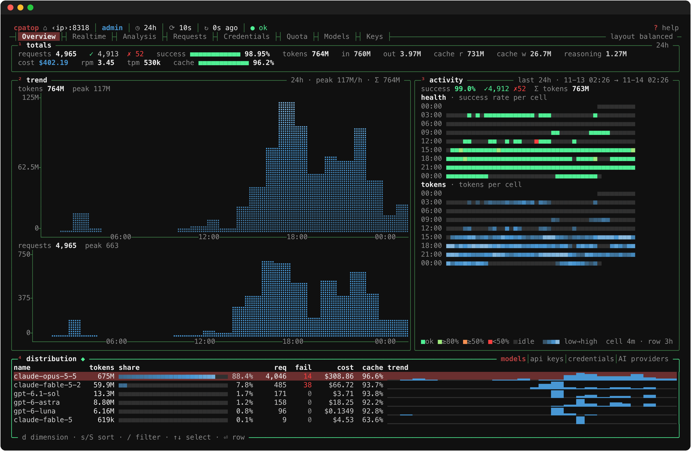

<sub>Admin overview, captured from a live Keeper at 160×48 with `--privacy`. More in [Screenshots](#screenshots).</sub>

A btop-style terminal dashboard for [CPA Usage Keeper](https://github.com/Willxup/cpa-usage-keeper)
(the usage/cost tracker for CLIProxyAPI), written in Rust with [ratatui](https://ratatui.rs).

It mirrors the Keeper web dashboard in your terminal: totals and trends, realtime
throughput, per-model / per-key / per-credential analysis, a live request log,
credential health, quota windows, pricing and sessions — with braille graphs,
gradient meters and sparklines.

## Features

- **Both Keeper roles.** An *admin* session gets every tab (Overview, Realtime,
  Analysis, Requests, Credentials, Quota, Models, Keys); a *CPA API key* session
  gets the per-key dashboard (Overview, Realtime, Analysis). The UI adapts to
  the role the server reports.
- **Live request log** over Server-Sent Events, with reconnect/backoff,
  `Retry-After` handling, `reset` frames and an idle watchdog; result, model
  and source filters run on the server, and scrolling to the bottom pages in
  older matching requests.
- **Time ranges** from presets or custom day/hour ranges, and an API-key
  filter, both through searchable pickers.
- **btop look:** rounded panes with `─¹ name ─` titles, braille/block/ascii
  graphs with axes, time ticks and a cursor, `■` meters, per-row sparklines,
  right-aligned numbers, labelled heatmaps.
- **Responsive:** panes and columns size to their content from 220×60 down
  to 80×24; when rows run out, low-priority panes collapse to one-line
  summaries instead of being squeezed.
- **Never blocks on the network:** each data group is polled by its own task on
  its own cadence; when a poll fails the last good data stays on screen and
  the header shows a stale marker.
- **Themes:** `default` (btop-like), `light`, `gruvbox`, `nord`, `tokyo-night`,
  `dracula`, `monochrome`, plus your own TOML themes.
- Persists theme, range, layouts, hidden panes, sorting and the last tab.

## Screenshots

All captured from a live Keeper with `--privacy`, reached at
`http://127.0.0.1:8318` to show that even the server address is masked:
e-mail addresses become `account-N`, API keys are shown only as `key #id`,
IP addresses become `‹ip›`.

| | |
|---|---|
| 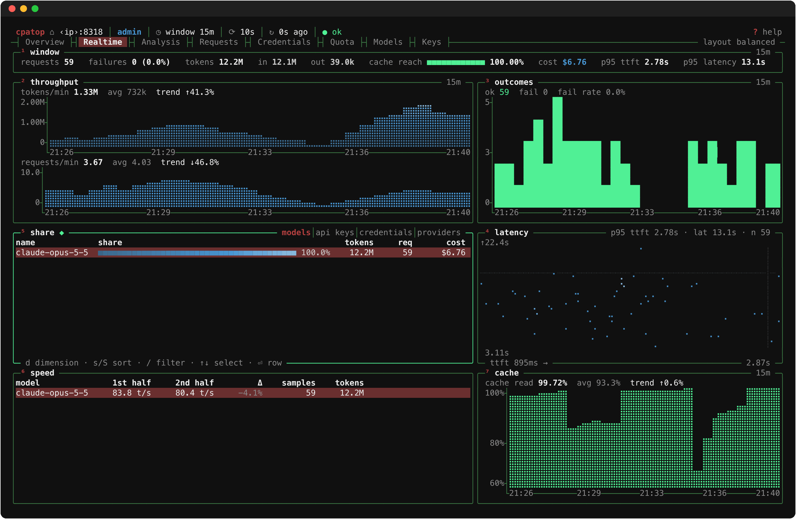 | 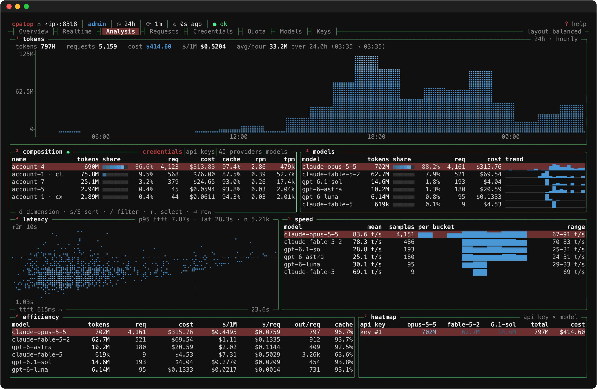 |
| **Realtime** — throughput, outcomes, latency scatter, cache hit rate over the last 15 minutes | **Analysis** — token trend, composition, latency, speed, efficiency and key × model heatmap |
| 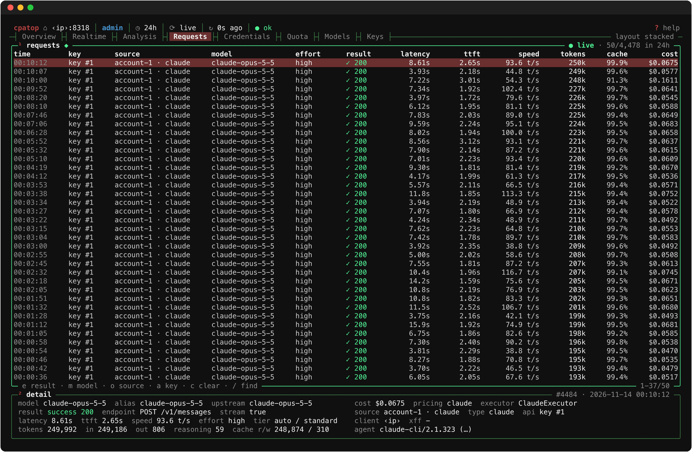 | 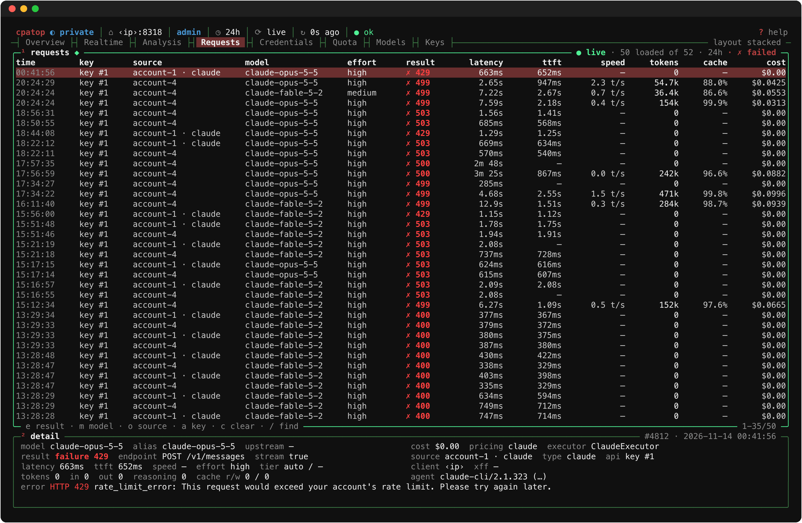 |
| **Requests** — live request log over SSE with a detail pane | **Server-side filters** — `e` shows failures only; `m`/`o` pick a model or source |
| 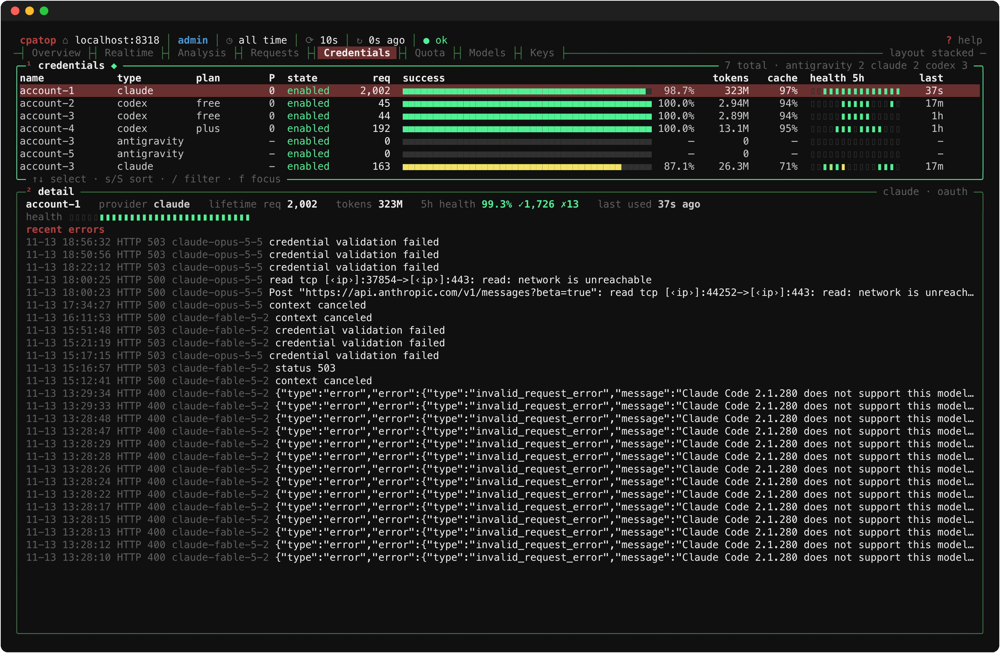 | 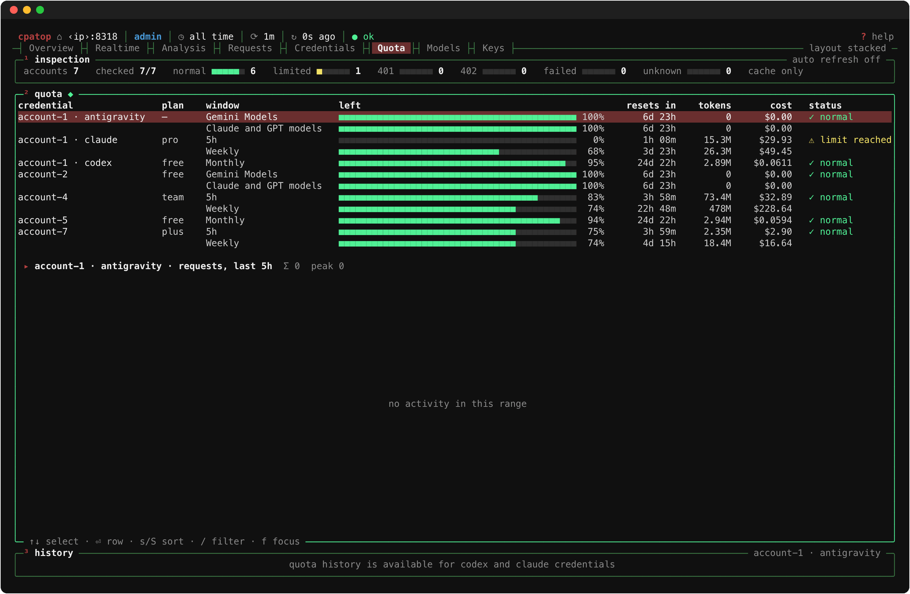 |
| **Credentials** — per-credential health, success rate and recent errors | **Quota** — every quota window per credential, with history |
| 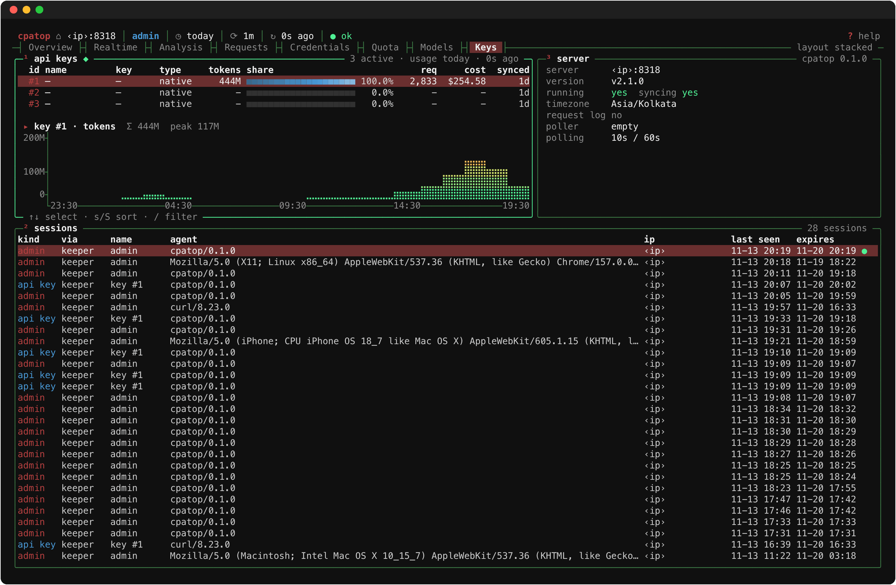 | 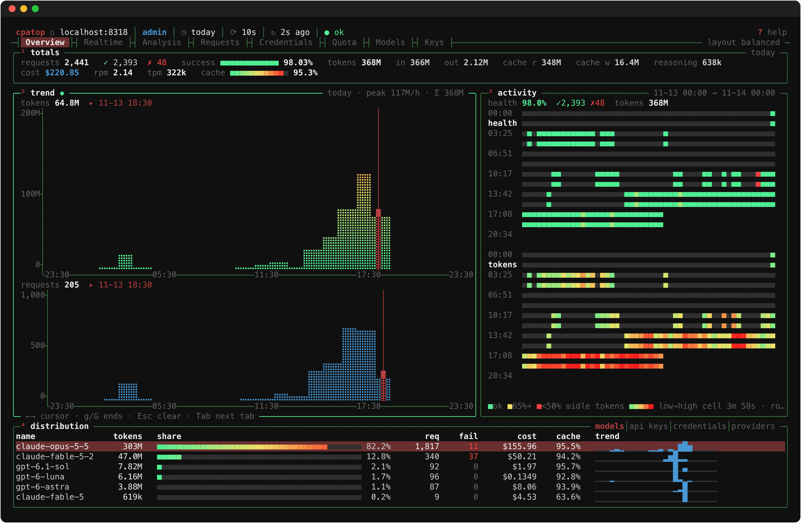 |
| **Keys** — API keys with usage for the selected range, sessions | **Graph cursor** — `f` focuses a graph, `←`/`→` read exact bucket values |
| 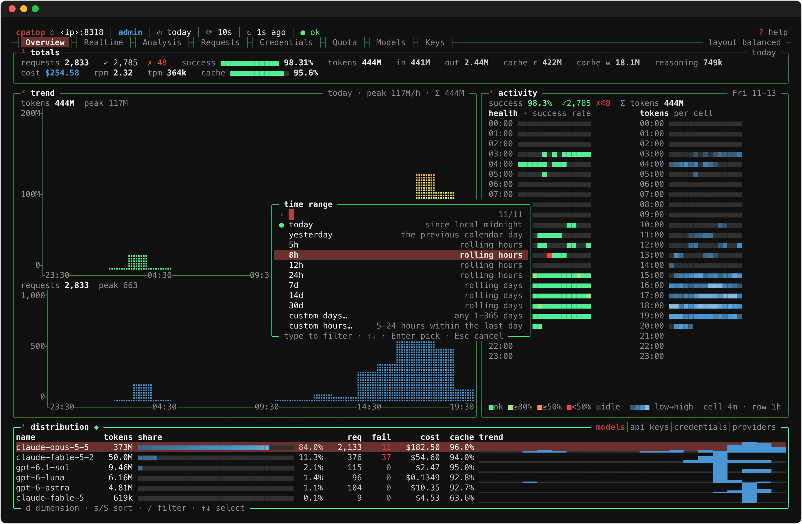 | 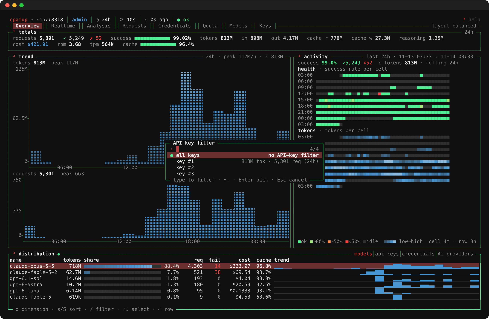 |
| **Range picker** (`r`) — presets plus custom day/hour ranges | **API-key picker** (`a`) — searchable, keys named by id |
|  | 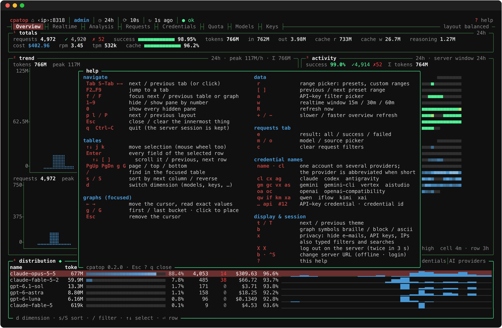 |
| **API-key mode** — the per-key dashboard | **Help** — `?` lists every key |
| 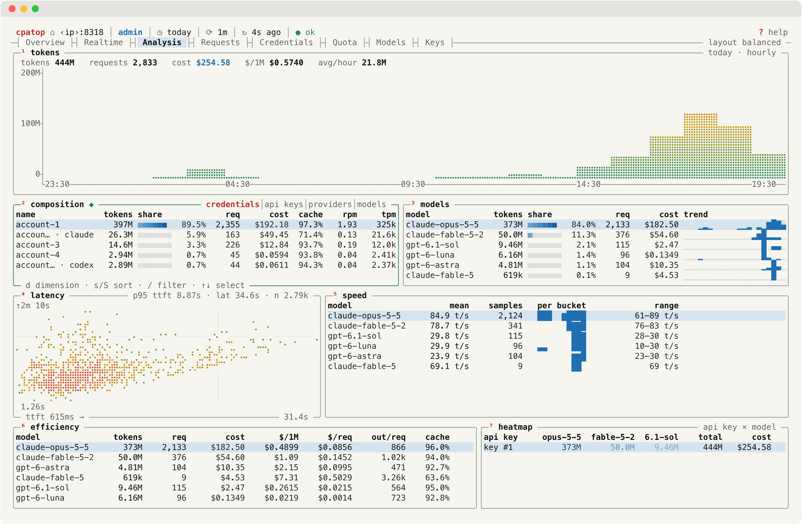 | 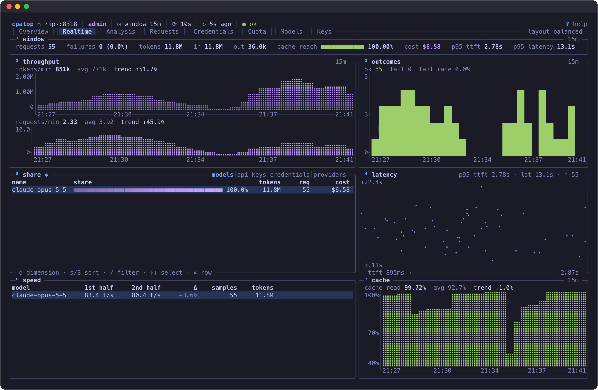 |
| **`light` theme** (Analysis) | **`tokyo-night` theme** (Realtime) |
| 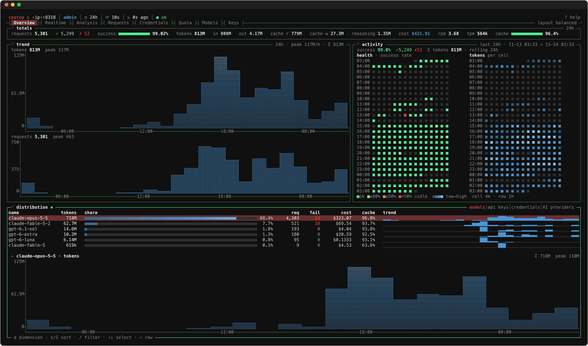 | 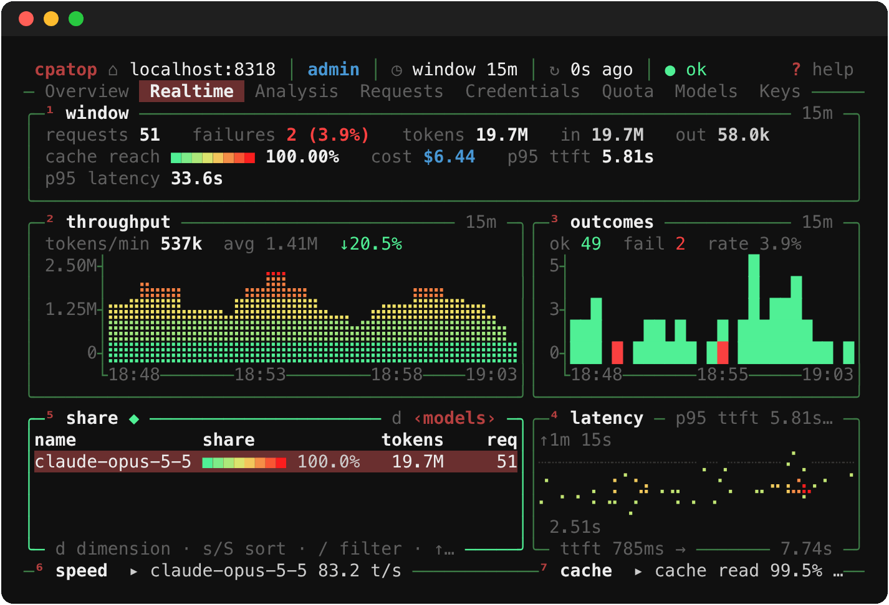 |
| **220×60** — panes size to their content | **80×24** — low-priority panes collapse to one-line summaries |

## Install

```sh
curl -fsSL https://raw.githubusercontent.com/alimohammed1624/cpatop/main/install.sh | sh
```

The script picks the prebuilt binary for your machine — Linux x86_64 or
aarch64 (static musl), macOS Intel or Apple silicon — from the latest
[GitHub release](https://github.com/alimohammed1624/cpatop/releases),
checks it against the release's `SHA256SUMS` and installs it to
`~/.local/bin` without sudo (it tells you the line to add if that is not on
your `PATH`). Options:

- `CPATOP_INSTALL_DIR=/some/dir` — install somewhere else.
- `CPATOP_VERSION=v0.1.0` — install a specific release instead of the latest.

```sh
curl -fsSL https://raw.githubusercontent.com/alimohammed1624/cpatop/main/install.sh | CPATOP_INSTALL_DIR=~/bin sh
```

To read the script before running it:

```sh
curl -fsSL https://raw.githubusercontent.com/alimohammed1624/cpatop/main/install.sh -o install.sh
less install.sh
sh install.sh
```

**Uninstall:** run `cpatop logout` to end your server sessions, then delete
the binary (`rm ~/.local/bin/cpatop`). `cpatop paths` lists the config and
state directories, which you can delete too.

**Release archives by hand.** Each release has these archives plus
`SHA256SUMS`; each `cpatop-<target>.tar.gz` contains a `cpatop-<target>/`
directory with the binary:

| Archive | Platform |
| --- | --- |
| `cpatop-x86_64-unknown-linux-musl.tar.gz` | Linux x86_64 (static) |
| `cpatop-aarch64-unknown-linux-musl.tar.gz` | Linux aarch64 (static) |
| `cpatop-x86_64-apple-darwin.tar.gz` | macOS Intel |
| `cpatop-aarch64-apple-darwin.tar.gz` | macOS Apple silicon |
| `cpatop-universal-apple-darwin.tar.gz` | macOS, one binary for both (larger) |

The install script always picks the architecture-specific archive; download
the universal one by hand when you want a single binary that runs on both
Intel and Apple silicon Macs (e.g. to copy between machines).

```sh
base=https://github.com/alimohammed1624/cpatop/releases/latest/download
curl -fsSLO "$base/cpatop-universal-apple-darwin.tar.gz" -O "$base/SHA256SUMS"
grep ' cpatop-universal-apple-darwin.tar.gz$' SHA256SUMS | shasum -a 256 -c
tar xzf cpatop-universal-apple-darwin.tar.gz
install -m 755 cpatop-universal-apple-darwin/cpatop ~/.local/bin/
```

On Linux, use `sha256sum -c` and the `-unknown-linux-musl` archive name.

**With cargo** (Rust 1.88+):

```sh
cargo install --git https://github.com/alimohammed1624/cpatop --locked
```

**From source:**

```sh
git clone https://github.com/alimohammed1624/cpatop && cd cpatop
cargo build --release            # target/release/cpatop
# static Linux build:
rustup target add x86_64-unknown-linux-musl
cargo build --release --target x86_64-unknown-linux-musl
```

TLS uses rustls, so no OpenSSL is needed. OS-keyring support (macOS
Keychain, freedesktop Secret Service) is on by default; build with
`--no-default-features` to leave it out.

## Usage

```sh
# Admin dashboard, password read from a file
cpatop --password-file ~/.config/cpatop/admin.pw

# Per-key dashboard
cpatop --api-key-file ~/.config/cpatop/cpa.key

# Different server, including a sub-path deployment
cpatop --base-url https://host.example/keeper
CPATOP_BASE_URL=https://host.example/keeper cpatop

# No credential configured: an in-app login screen (Admin / API key) appears
cpatop
```

Other commands:

| Command | Purpose |
|---|---|
| `cpatop keyring set admin` / `api-key` | Store a secret in the OS keyring (hidden prompt) |
| `cpatop keyring delete admin` / `api-key` | Remove it |
| `cpatop logout` | Log out on the server and forget the stored session |
| `cpatop themes [--dump NAME]` | List themes / print one as a TOML starting point |
| `cpatop paths` | Show the config, theme and state paths in use |

Useful flags: `--range 7d` (or `--range custom:2026-11-01..2026-11-07`),
`--refresh 5`, `--theme nord`, `--symbols block`, `--auth api-key` (prefer the
key when both credentials exist), `--privacy` (hide e-mails, keys and IPs),
`--no-mouse`, `--no-keyring`, `--fresh-session`, `--logout-on-exit`.

Sessions are remembered per server and role, and a stored session is checked
with the server (`GET /auth/session`) and reused on the next start — cpatop
only logs in again when it is no longer valid. **`q` keeps the server session**
for next time; `cpatop logout` (or `X X` in the app) ends it, and
`--logout-on-exit` (config `logout_on_exit = true`) ends it whenever you quit. A credential given explicitly
for this run (`--password-file`, `--api-key-file`, `CPATOP_PASSWORD`,
`CPATOP_API_KEY`) decides the role, so `--api-key-file` always opens the
per-key dashboard even when an admin session is stored.
Run `cpatop --help` for the full list.

## Keys

The focused pane lists its own keys in its bottom border; `?` shows them all.

| Key | Action |
|---|---|
| `Tab` / `Shift-Tab`, `←` `→` | Next / previous tab (or click a tab); `F2`…`F9` jump to a tab |
| `f` / `F` | Focus the next / previous table or graph (or click a pane) |
| `1`–`9` | Hide / show the pane with that number |
| `p` / `l`, `P` | Next / previous layout preset |
| `↑↓` `j`/`k`, `PgUp`/`PgDn`, `g`/`G` | Move the selection (mouse wheel scrolls) |
| `/` | Find in the focused table (`Enter` keeps, `Esc` clears) |
| `s` / `S` | Sort by the next column / reverse |
| `d` | Switch dimension: models, API keys, credentials, providers |
| `←` `→`, `g` `G` (graph focused) | Move the graph cursor and read exact bucket values; `Esc` removes it |
| `r` | Range picker: presets, custom days (YYYY-MM-DD), custom hours |
| `[` `]` | Previous / next preset range |
| `a` | API-key filter picker (admin) — type to search, `Enter` picks |
| `w` | Realtime window 15m / 30m / 60m |
| `e` | Requests: result filter all / success / failed (server-side) |
| `m` / `o` | Requests: model / source picker (server-side) |
| `c` | Requests: clear the filters |
| `+` / `-` | Slower / faster refresh |
| `R` | Refresh now |
| `t` / `T` | Next / previous theme |
| `b` | Graph symbols: braille / block / ascii |
| `x` | Privacy mode: hide e-mails, API keys and IP addresses |
| `X` `X` | Log out on the server (press twice within 3 s) |
| `Esc` | Close the overlay / clear the filter or cursor — never quits |
| `?` | Help (scrolls with `↑↓` `j`/`k` `PgUp`/`PgDn` `g`/`G` or the wheel; `Esc`, `?` or `q` close it) |
| `q`, `Ctrl-C` | Quit — the server session is kept for the next start |

## Configuration

`$XDG_CONFIG_HOME/cpatop/config.toml` (see [`config.example.toml`](config.example.toml)).
Precedence: command line and environment → saved UI state → config file → defaults.

| File | Location |
|---|---|
| Config | `$XDG_CONFIG_HOME/cpatop/config.toml` |
| UI state (written automatically) | `$XDG_CONFIG_HOME/cpatop/ui-state.toml` |
| User themes | `$XDG_CONFIG_HOME/cpatop/themes/*.toml` |
| Session cookie (mode 0600) | `$XDG_STATE_HOME/cpatop/session.json` |

On macOS without `XDG_*` variables the platform directories are used
(`cpatop paths` prints them).

Polling defaults: overview/realtime every 10 s (`+`/`-`, `--refresh`),
analysis, credentials, quota and keys every 60 s (`slow_refresh_secs`),
models on entry, range change or `R`; the request log is a live stream. The
header shows the cadence of the tab on screen (`⟳ 10s`, `⟳ 1m`, `⟳ live`,
`⟳ on R`) and turns the age amber when refreshes were missed; panes whose
data is that old show `◌ stale`.

## Themes

A theme is a flat TOML file; every key is optional and falls back to the
`default` theme. Colours are `#rrggbb`, `#rgb`, an ANSI name (`red`,
`darkgray`, …) or `default` for the terminal's colour.

```toml
# ~/.config/cpatop/themes/mine.toml  →  selectable as "mine"
name = "mine"
main_bg = "default"
main_fg = "#cccccc"
title = "#eeeeee"
hi_fg = "#b54040"         # pane numbers, highlights
border = "#3d7b46"
border_focus = "#50f095"
selected_bg = "#6a2f2f"
selected_fg = "#eeeeee"
inactive_fg = "#8a8a8a"
graph_text = "#8a8a8a"
meter_bg = "#303030"      # empty meter cells
gradient_low = "#50f095"  # graph/meter gradient, bottom → top
gradient_mid = "#f2e266"
gradient_high = "#fa1e1e"
ok = "#50f095"
warn = "#f2e266"
err = "#fa4040"
accent = "#4897d4"
```

`cpatop themes --dump nord > ~/.config/cpatop/themes/my-nord.toml` gives you a
complete starting point. A user theme with a built-in name replaces it.

## Security

- **No secrets on the command line.** Credentials come from
  `--password-file`/`--api-key-file` (or the same keys in the config file),
  `CPATOP_PASSWORD`/`CPATOP_API_KEY`, the OS keyring, or the login screen —
  in that order. cpatop warns when a secret file is readable by others.
- **Only the session cookie is persisted**, never the password or API key, in a
  0600 file in the state directory. It is reused until the server answers 401;
  then cpatop logs in again if a credential source is available, otherwise it
  shows the login screen. A secret typed into the login screen is kept in
  memory only.
- Secrets are never logged or rendered (the login field shows bullets).
  API keys returned by the server are shown the way the web dashboard
  shows them — the server's own masked form, short prefix and six-character
  suffix (`abc…x1y2z3`); the raw-key endpoint `/usage/api-keys/settings` is
  never called.
- cpatop only issues GET requests, plus `POST /auth/login`,
  `/auth/api-key-login` and `/auth/logout`. It never changes Keeper settings
  or data, never triggers quota refreshes and never calls the GitHub-backed
  update check.
- `--privacy` (or `x`) hides every e-mail address (shown as `account-N`),
  every part of an API key (keys are `key #id`) and every IP address
  (`‹ip›`, including the server address in the header and inside URLs), in
  tables, details, pickers, error text and the login and offline screens —
  handy for screenshots and screen sharing. Host names such as `localhost`
  stay visible.

## Development

```sh
cargo fmt --check
cargo clippy --all-targets -- -D warnings
cargo test
```

Tests parse every recorded API response in `tests/fixtures/` (scrubbed real
Keeper v2.1.0 responses), snapshot the main screens with ratatui's
`TestBackend` at 80×24, 160×48 and 220×60 for both roles (`tests/snapshots/`,
via [insta](https://insta.rs)), check that privacy mode leaves no identifier
on any screen, drive the key bindings (`tests/keys.rs`) and run the client,
pollers, live stream and session handling against a mock Keeper
(`tests/http.rs`, via wiremock).

Releases: push a `v*` tag; `.github/workflows/release.yml` builds the
binaries and attaches them to the GitHub release. See
[CHANGELOG.md](CHANGELOG.md).

`scripts/screenshots.sh` regenerates the PNGs in `docs/screenshots/` from a
running Keeper (needs tmux, aha, chromium, ImageMagick and the "MesloLGS Nerd
Font Mono" font). It always runs cpatop with `--privacy` and throwaway config
and state directories, and logs its sessions out when done:

```sh
CPATOP_BASE_URL=http://localhost:8318 \
CPATOP_SHOT_PASSWORD_FILE=path/to/admin.pw \
CPATOP_SHOT_API_KEY_FILE=path/to/cpa.key \
  scripts/screenshots.sh            # SHOT_ONLY="admin-overview" for one scene
```

## License

MIT — see [LICENSE](LICENSE).
